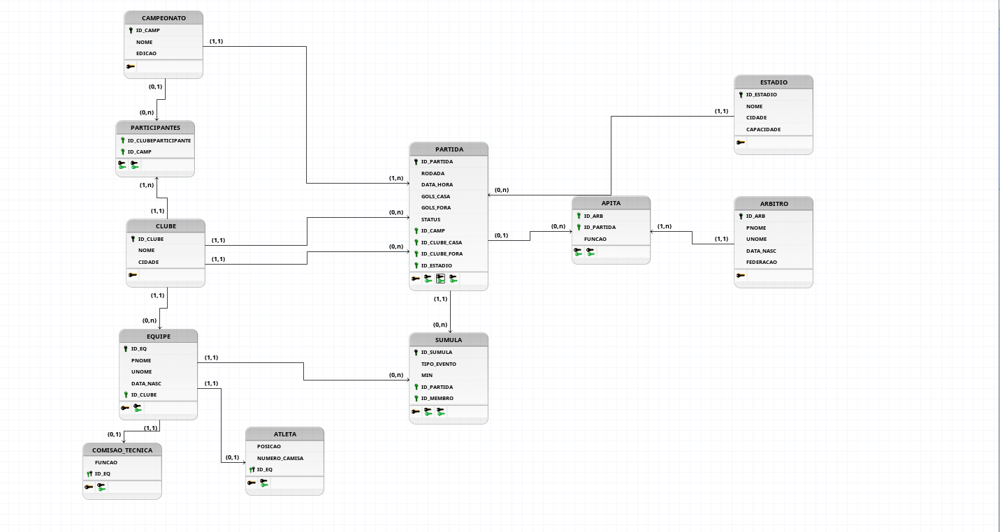
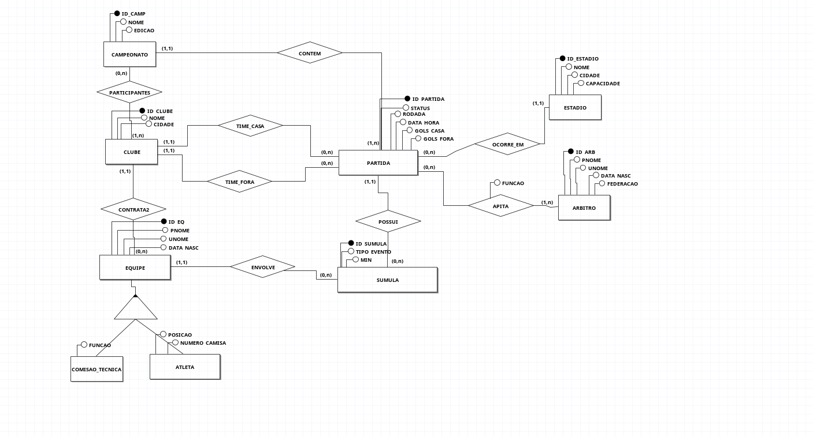

# LeagueCamp: Sistema de Gerenciamento de Ligas de Futebol

## Sobre o projeto


O objetivo é desenvolver um sistema web que permita organizar e acompanhar campeonatos de futebol, reunindo informações sobre clubes, estádios, árbitros, elencos, partidas e os eventos de cada jogo.

O sistema busca facilitar a administração de uma liga, permitindo cadastrar e editar os acontecimentos do campeonato em uma página de gestão e consultar os dados em uma página exclusiva de consultas, com o código SQL de cada consulta exibido na tela.

O desenvolvimento contempla a modelagem conceitual e relacional no brModelo, a implementação do banco de dados em PostgreSQL e a construção de uma aplicação web com interface gráfica, usando SQL escrito manualmente, sem ORM.

## Funcionalidades previstas

O sistema está sendo desenvolvido para oferecer as seguintes funcionalidades:

### Página de Gestão (criar e editar)

- **Gerenciamento de campeonatos:** cadastrar, editar e excluir campeonatos e suas edições.
- **Inscrição de clubes:** vincular os clubes participantes a cada campeonato.
- **Gerenciamento de clubes:** cadastrar e editar clubes e suas cidades.
- **Gerenciamento de estádios:** registrar estádios, cidades e capacidades.
- **Gerenciamento de árbitros:** cadastrar árbitros e seus dados pessoais.
- **Gerenciamento de elenco:** cadastrar atletas e membros da comissão técnica de cada clube.
- **Gerenciamento de partidas:** agendar jogos, registrar placar, alterar status e escalar árbitros.
- **Súmula da partida:** registrar gols, cartões e demais eventos com o minuto de cada um.

### Página de Consultas (somente leitura)

- **Classificação:** pontos, vitórias, empates, derrotas, gols e saldo por campeonato.
- **Artilheiros:** jogadores com mais gols no campeonato.
- **Partidas:** jogos por rodada e histórico de um clube.
- **Elencos:** atletas e comissão técnica por clube.
- **Disciplina:** cartões por clube.
- **Arbitragem:** árbitros escalados por partida e ranking de jogos apitados.
- **Estádios:** média de gols por estádio.
- **Consultas avançadas:** goleadas, clubes sem jogos, atletas sem gols e clubes acima da média (subconsultas).

## Tecnologias utilizadas

- Java 17
- Spring Boot
- Spring Web
- Thymeleaf
- Spring JDBC (`JdbcTemplate`)
- PostgreSQL
- Maven
- brModelo (modelagem do banco de dados)
- HTML e CSS

## Modelagem do banco de dados

O banco `LeagueCamp` possui 11 tabelas:

| Tabela | Descrição |
|---|---|
| CAMPEONATO | Campeonatos e suas edições |
| CLUBE | Clubes cadastrados |
| ESTADIO | Estádios e capacidades |
| ARBITRO | Árbitros |
| EQUIPE | Pessoas vinculadas a um clube (generalização) |
| ATLETA | Posição e número da camisa |
| COMISSAO_TECNICA | Função na comissão técnica |
| PARTICIPANTES | Clubes inscritos em cada campeonato |
| PARTIDA | Jogos, placar e status |
| APITA | Árbitros escalados em cada partida |
| SUMULA | Eventos ocorridos na partida |

### Modelo entidade_relacionamento



### Modelo relacional



### Script de criação do banco

O script SQL com a criação de todas as tabelas, chaves e restrições está em [`docs/sql/criacao_banco.sql`](docs/sql/criacao_banco.sql).

## Como executar

### Pré-requisitos

- JDK 17
- Maven (ou o `mvnw` que acompanha o projeto)
- PostgreSQL

### Passo a passo

1. Clone o repositório:

   ```bash
   git clone [LINK DO REPOSITÓRIO]
   cd leaguecamp
   ```

2. Crie o banco de dados:

   ```sql
   CREATE DATABASE "LeagueCamp";
   ```

3. Defina a senha do banco como variável de ambiente (o usuário padrão é `postgres`):

   ```bash
   export DB_SENHA=sua_senha
   ```

   Para usar outro usuário, defina também `DB_USUARIO`.

4. Execute a aplicação:

   ```bash
   ./mvnw spring-boot:run
   ```

5. Acesse no navegador:

   - Página inicial: `http://localhost:8080`
   - Gestão: `http://localhost:8080/gestao`
   - Consultas: `http://localhost:8080/consultas`

As tabelas são criadas automaticamente na primeira execução, a partir do arquivo `schema.sql`.

## Estrutura do projeto

```
leaguecamp/
├── docs/
│   ├── PLANEJAMENTO.md        # planejamento e funções de cada página
│   ├── diagrama/              # modelos conceitual e relacional
│   └── sql/                   # script de criação do banco
├── src/main/java/br/com/leaguecamp/leaguecamp/
│   ├── controller/            # páginas de gestão e consultas
│   ├── repository/            # todo o SQL do projeto
│   ├── model/                 # classes de dados
│   └── exception/             # tratamento de erros
├── src/main/resources/
│   ├── templates/             # páginas Thymeleaf
│   ├── static/                # CSS e JavaScript
│   ├── schema.sql             # criação das tabelas
│   ├── data.sql               # dados de exemplo
│   └── application.properties # configuração da aplicação
└── pom.xml
```


## Status do desenvolvimento

- [x] Modelagem conceitual e relacional
- [x] Script de criação do banco
- [x] Projeto Spring Boot e conexão com o PostgreSQL
- [ ] Dados de exemplo (`data.sql`)
- [ ] Página de Gestão
- [ ] Página de Consultas
- [ ] Testes e ajustes finais

